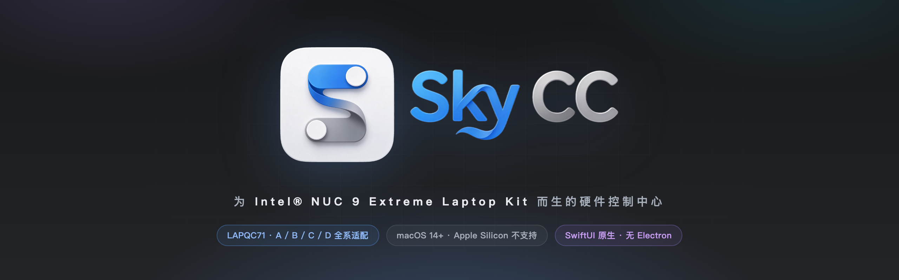

<div align="center">



# Sky CC

**为 Intel® NUC 9 Extreme Laptop Kit（LAPQC71 系列）打造的 macOS 硬件控制中心**

[](#-安装)
[](#-安装)
[](#-硬件适配)
[](#-许可)
[](#-架构)

**性能监测 · 设备控制 · 灯光矩阵 · 驱动维护 —— 一切以硬件真实回读为准**

</div>

---

## ✨ 它能做什么

| | 能力 | 一句话说明 |
|---|---|---|
| 📈 | **性能监测** | 每秒一次快照取全：CPU 实时频率（`IA32_PERF_STATUS`）/ 六核占用 / 封装温度功耗 / dGPU / 内存 / 网络 / NVMe S.M.A.R.T.，90 秒曲线同屏 |
| 🎛 | **设备控制** | 显卡路由热切换（无需注销）、散热模式（安静 / 均衡 / Boost）、风扇手动档位与温控曲线、电池充电阈值、触摸板 / Fn 锁 —— 每个开关都按 EC 位回读确认 |
| ⌨ | **灯光矩阵** | 键盘 RGB 四区独立调色、海岸灯 |
| 🖥 | **NVIDIA 驱动** | 自维护 fork 版本对照、一键下载安装、组件级卸载 |
| 📶 | **网卡驱动** | AX200 二合一驱动包（Wi-Fi + 蓝牙 + AirDrop 修复），版本对照一键更新 |
| 🗺 | **状态栏** | 菜单栏逐项监控：频率 / 温度 / 风扇转速 / 网速 / 磁盘健康，逐项开关 |

## 🏗 架构

```
┌─────────────────────────────────────────────────┐
│  Sky CC.app（SwiftUI）                          │
│  界面 · 皮肤引擎 · 更新器 —— 不碰硬件            │
└──────────────────────┬──────────────────────────┘
                       │ XPC（每秒一次快照）
┌──────────────────────▼──────────────────────────┐
│  SkyCCHelper（唯一特权后台进程）                  │
│  EC / SMC / MSR / HID 全部收口在这里             │
└───┬──────────────┬───────────────┬──────────────┘
    │              │               │
┌───▼───────┐ ┌────▼─────┐ ┌───────▼────────┐
│ SkyCCEC   │ │ SMC/MSR  │ │ gpu-router     │
│ .kext     │ │ 直读     │ │ .dylib         │
│ EC 通道   │ │ 频率温度 │ │ Metal 默认设备 │
└───────────┘ └──────────┘ └────────────────┘
```

**设计原则**：app 崩了不碰硬件、硬件读不到不猜数、每个写操作必须回读校验。

## 📥 安装

> 应用内「检查更新」三条通道自动择优。

下载 `Sky CC-<版本>-LAPQC71x.dmg`，打开后拉起自研安装器，一键完成主程序 / EC 内核扩展 / GPU 路由库部署。安装包支持覆盖安装与降级安装。

<details>
<summary><b>从 3.0.x 升级（标识换域注意事项）</b></summary>

3.1.0 起应用标识由 `com.macconsole.*` 换成 `com.skycc.*`（外壳、后台助手、内核扩展、开机自启都换了域）：

- **内核扩展**：旧标识的 kext 仍能继续驱动硬件（驱动里按 IOClass 匹配，不认 bundle id），功能不受影响。想让标识统一、以后卸载更干净，可以在「设备控制」页点一次「立即安装」，脚本会自动卸旧装新
- **开机自动启动**：需要重新打开一次。系统按应用标识记录登录项，换标识后旧记录失效，开关会显示关闭
- **偏好设置与数据目录**：首次启动自动从旧位置迁移，完成后弹一条提示

装完新版本后，旧的 `Sky CC.app` 已被同名覆盖，不需要单独卸载。

</details>

## 🔧 硬件适配

| 机型 | 出厂独显 | 判定（device-id） |
|---|---|---|
| LAPQC71 | RTX 1660 Ti Max-Q | `0x2182` |
| LAPQC71B | RTX 2070 Max-Q | `0x1F11` |
| LAPQC71C | RTX 2060 Mobile | `0x1F51` |
| LAPQC71D | RTX 2070 Super Max-Q | `0x1E34` |

CPU 全系 i7-9750H + HM370；机型按出厂独显 device-id 自动判定子型号。

## 📜 许可

本项目整体以 **GPL-2.0** 发布。

## ⚠️ 声明

本程序为社区驱动项目，与 **英特尔（Intel）** 官方无关，也不获得其任何支持或背书。
`Intel`、`Intel® NUC` 是 Intel Corporation 的商标；`NVIDIA` 是 NVIDIA Corporation 的商标。

直接操作 EC / MSR / SMC 意味着绕过厂商保护层——**使用本软件的一切风险由使用者自行承担**。

---

<div align="center">
<sub>Sky CC · 为老硬件续一秒 🚀</sub>
</div>
